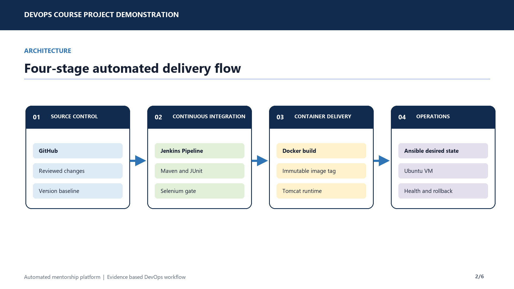
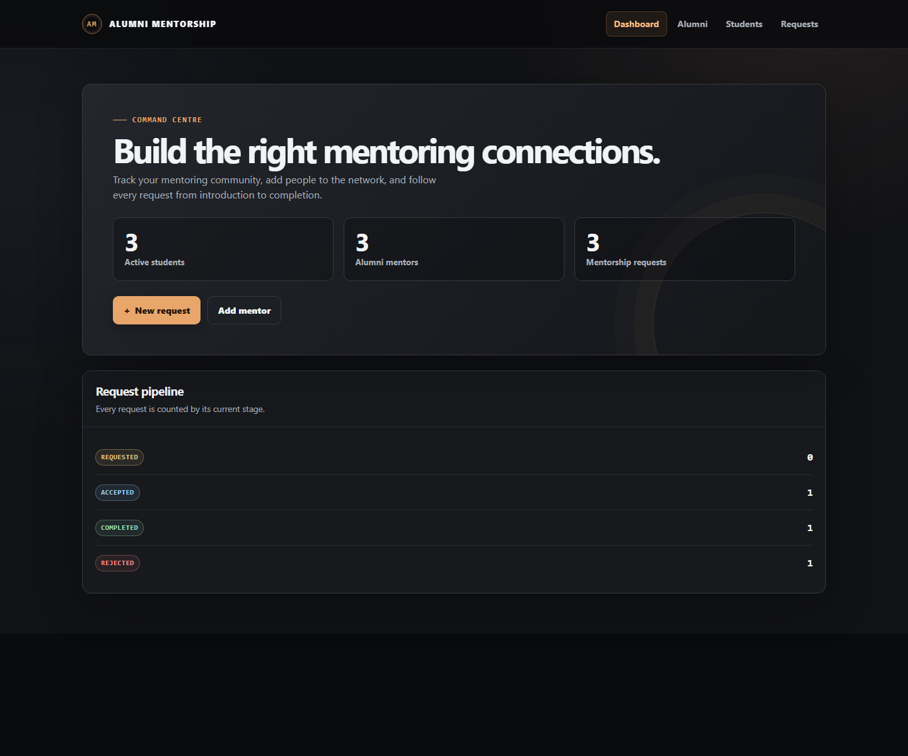
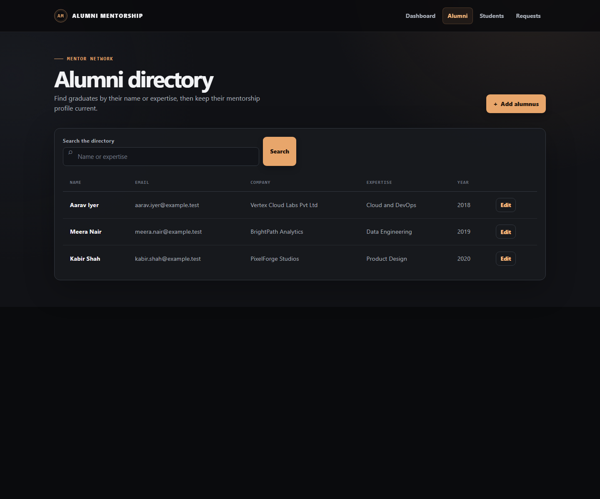
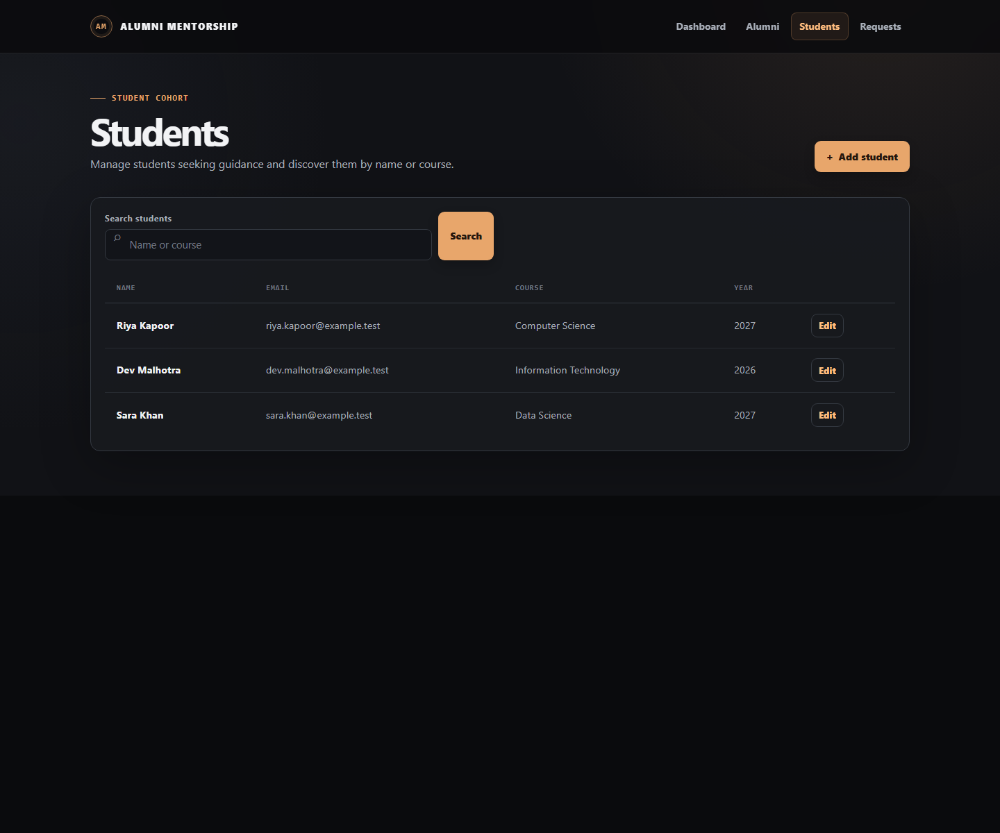
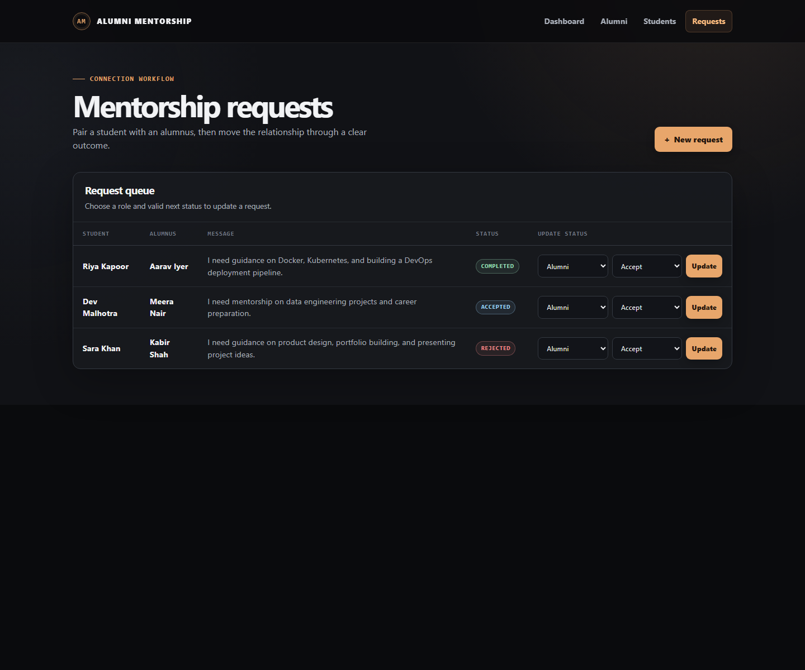
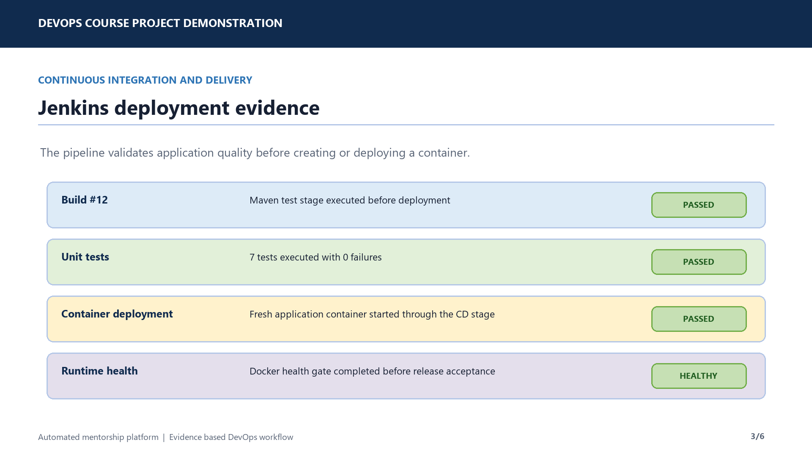
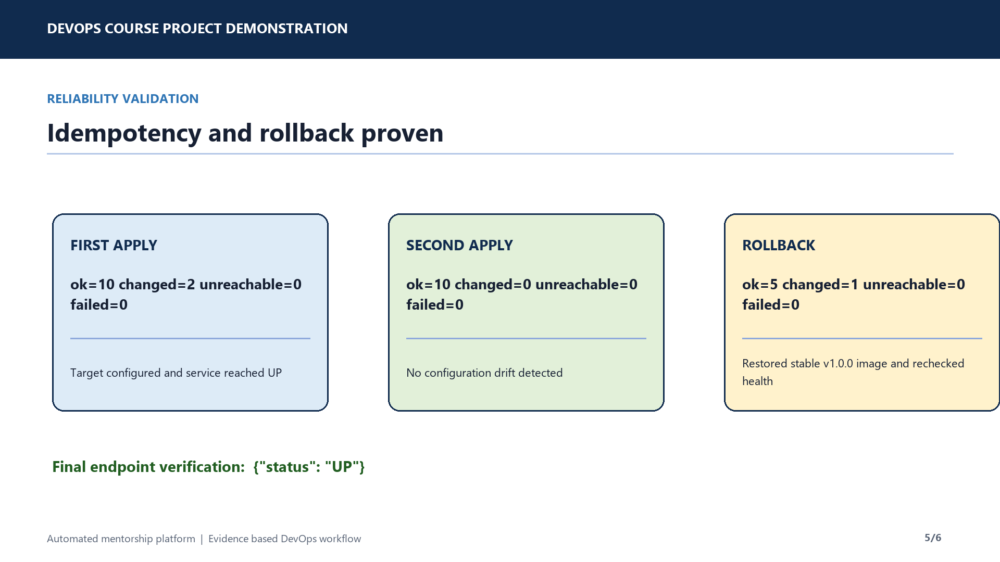

<p align="center">
  
</p>

# Automated Alumni Mentorship Platform Deployment

<p>
  
  
  
  
  
  
</p>

A final-year CSE DevOps project that delivers a Spring Boot alumni mentorship application and an evidence-based, repeatable path from reviewed source code to a health-verified Ubuntu deployment.

## Project goal

The platform manages student and alumni records, mentor discovery, mentorship requests, role-aware workflow transitions, and dashboard reporting. Its DevOps implementation makes every release traceable through source control, quality gates, container packaging, infrastructure automation, health validation, and rollback.

## Live demo

Open the public application at [adrian-alumni-mentorship.onrender.com/alumni-mentorship](https://adrian-alumni-mentorship.onrender.com/alumni-mentorship/).

> The Render free instance spins down after inactivity, so the first visit after idle time can take about a minute to respond.

## Application walkthrough

The application starts on its dashboard, which acts as the landing page and summarizes the current mentoring network. Alumni are former students who can act as mentors; current students can be matched with them through a request. The screenshots below use fictional local demo data.

### Dashboard / landing page



### Alumni directory

Search alumni by name or expertise, add mentor profiles, and update their professional information.



### Students

Maintain student profiles and search by name or course before creating a mentorship request.



### Mentorship requests

Create a student-to-alumni request, then progress it through the role-aware workflow: an alumnus can accept or reject a new request, and an admin can complete an accepted request.



> The deployed demonstration uses the project’s in-memory H2 database. It automatically seeds the sample records shown above whenever the service starts with an empty database. Data added by visitors is available while the service is running but resets when the service restarts or redeploys.

## Delivery workflow

```text
GitHub -> Jenkins Pipeline -> Maven and Selenium Quality Gates -> Docker Image -> Ubuntu VM -> Health Check and Rollback
```

| Stage | Tooling | Outcome |
|---|---|---|
| Source control | Git, GitHub, pull requests, release tags | Reviewable and traceable changes |
| Continuous integration | Jenkins, Maven, JUnit, Selenium | Tests must pass before deployment |
| Container delivery | Docker, Tomcat 10, Docker Hub | Portable, versioned application runtime |
| Infrastructure as code | Ansible, Ubuntu VM | Repeatable target configuration |
| Reliability | Docker health check, rollback playbook | A verified `UP` response and stable-image recovery |

## Verified deployment evidence

<p align="center">
  
</p>

- Jenkins CD build **#12** passed **7 tests with 0 failures**, deployed the application container, and passed the Docker health gate.
- The Ubuntu target was provisioned through Ansible using the published immutable image `adrian255/alumni-mentorship:1-bd157e6`.
- The application health endpoint returned `{"status":"UP"}` after deployment.
- The second Ansible apply converged with `ok=10 changed=0 unreachable=0 failed=0`, proving idempotency.
- The rollback playbook restored `adrian255/alumni-mentorship:v1.0.0` and again verified application health.

<p align="center">
  
</p>

## Demo video

Watch the concise end-to-end project walkthrough: [deployment demonstration video](deliverables/automated-mentorship-devops-demo.mp4).

## Repository guide

| Area | Contents |
|---|---|
| [`app`](app) | Spring Boot application source, MVC views, tests, Docker and Maven configuration |
| [`task-1`](task-1) to [`task-6`](task-6) | Planning, Git workflow, collaboration, MVP and release baseline evidence |
| [`task-7`](task-7) to [`task-10`](task-10) | Jenkins CI, pipeline-as-code, Selenium testing, and quality-gate evidence |
| [`task-11`](task-11) to [`task-12`](task-12) | Docker lifecycle and Jenkins continuous-delivery evidence |
| [`task-13`](task-13) to [`task-14`](task-14) | Ansible provisioning, idempotency, rollback, and target health evidence |
| [`task-15`](task-15) | Final report, viva preparation, presentation outline, and submission checklist |
| [`deliverables`](deliverables) | Final demo video and presentation artifacts |

## Task evidence

| Task | Evidence |
|---|---|
| 1 | [Problem definition and scope](task-1/README.md) |
| 2 | [Agile plan and DevOps workflow](task-2/README.md) |
| 3 | [Requirements and architecture](task-3/README.md) |
| 4 | [Git and GitHub initialization](task-4/README.md) |
| 5 | [Feature branching and pull request review](task-5/README.md) |
| 6 | [MVP completion and release tag](task-6/README.md) |
| 7 | [Jenkins continuous integration](task-7/README.md) |
| 8 | [Pipeline as code and Tomcat deployment](task-8/README.md) |
| 9 | [Selenium browser testing](task-9/README.md) |
| 10 | [Continuous testing and failed-build evidence](task-10/README.md) |
| 11 | [Docker lifecycle](task-11/README.md) |
| 12 | [Jenkins Docker continuous delivery](task-12/README.md) |
| 13 | [Ansible target configuration](task-13/README.md) |
| 14 | [Idempotency, health validation, and rollback](task-14/README.md) |
| 15 | [Final release report and viva preparation](task-15/README.md) |

## Technology stack

Java 17, Spring Boot 3, Thymeleaf, H2, Maven, JUnit 5, Selenium WebDriver, Tomcat 10, Jenkins, Docker, Docker Hub, Ansible, and Ubuntu.

## Key practices demonstrated

- Pipeline as code through Jenkins declarative pipelines
- Automated unit and browser quality gates
- Immutable Docker image tags for release traceability
- Desired-state server configuration with Ansible
- Health-first deployment acceptance checks
- Idempotent infrastructure application and explicit stable-image rollback

Every task directory includes its own reproducibility notes and evidence. The application source is maintained once in [`app`](app).
